# Geonaut

Learn the world the way geography YouTubers know it: every country by its **shape**, **flag**, **place on the map**, **capital**, **clues** and **real photos**. Then go further, to states and provinces, rivers, seas, mountains and the world map through history. Your geography **IQ** tracks how good you really are: an IQ-style score where 100 is average and 15 points is one standard deviation.

**▶ Play in your browser: [geonaut.parthg.dev](https://geonaut.parthg.dev)** · **📱 Android: [latest APK](https://github.com/parthg1901/geonaut/releases/latest)**

Android app (Capacitor) and installable web app (PWA). Works offline for solo play; multiplayer, friends and sync need a connection.

<p>
  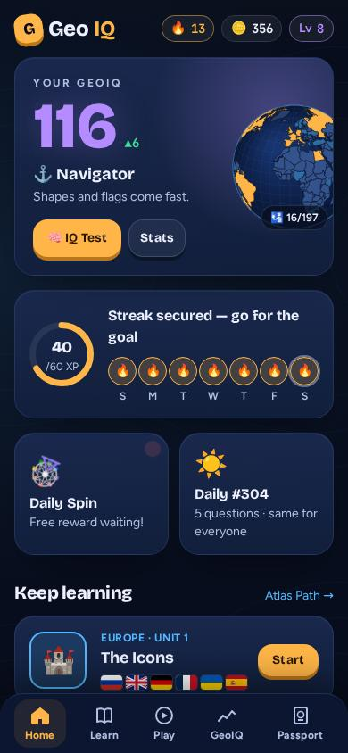
  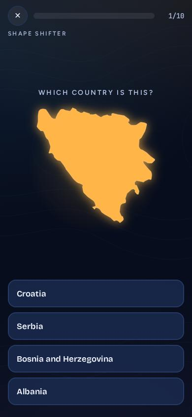
  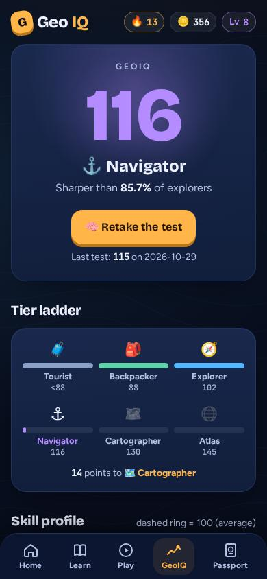
  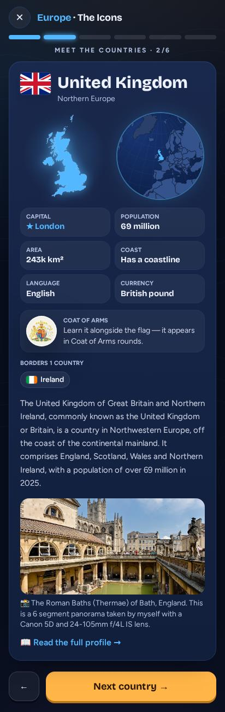
</p>
<p>
  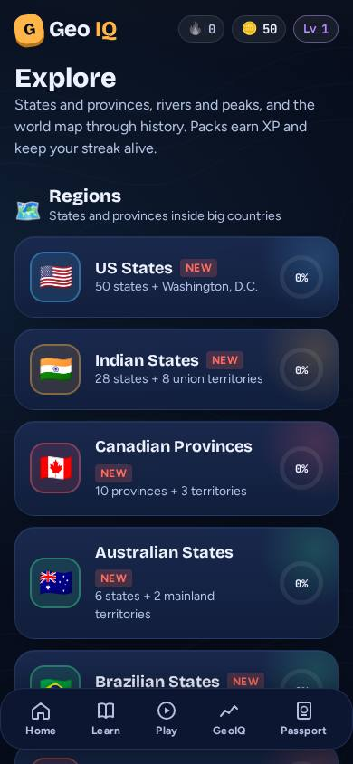
  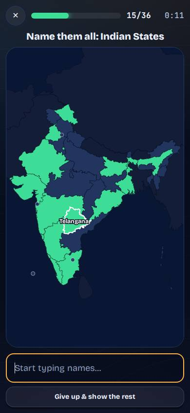
  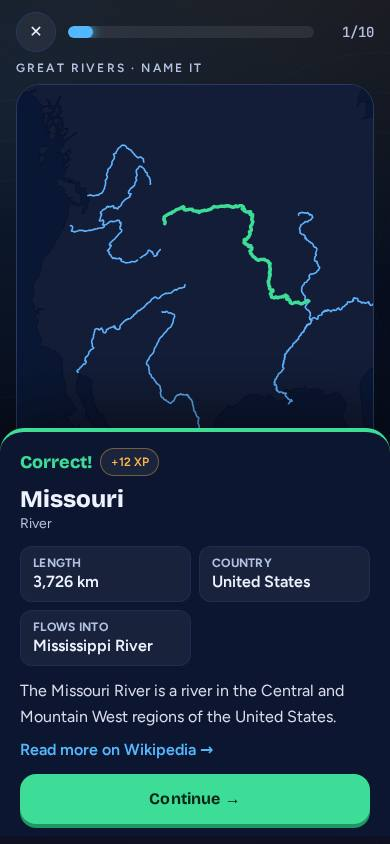
  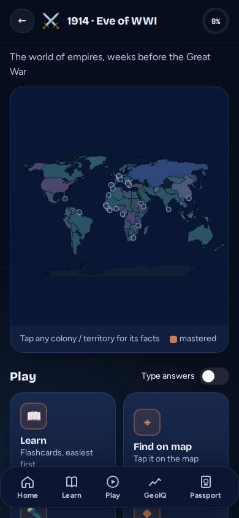
</p>
<p>
  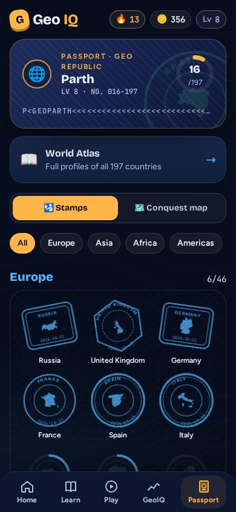
  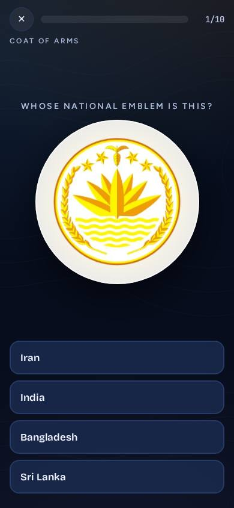
  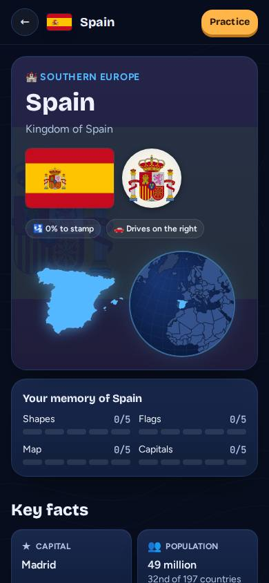
  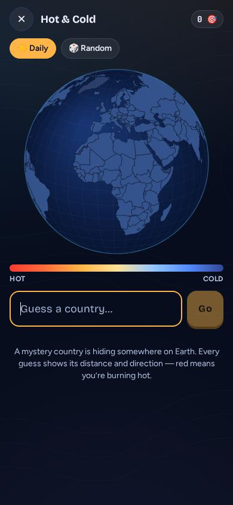
</p>

## Features

**Learn**
- **Atlas Path:** 33 units covering all 197 countries, famous ones first. Each country gets a card with its shape, flag, globe location, capital, population, area, languages, currency, coat of arms, neighbours and a real photo, followed by a practice round.
- **Smart Review:** spaced repetition brings back countries you're about to forget.
- **World Atlas:** a full profile for every country (key facts, world rankings, memberships, map, photo gallery and Wikipedia deep dives into history, geography, economy, culture, food and more).

**Play**
- **Core modes:** Shape Shifter, Flag Frenzy, Pin It (map), Capital Gains and Coat of Arms.
- **Deduction:** the Clue Ladder (fewer clues, more points).
- **Harder variants:** Twisted Shapes (rotated) and Shape Rush (60-second time attack).
- **Specials:** a Daily Challenge (the same 5 questions for everyone, with a shareable emoji grid), Hot & Cold (find the mystery country by distance) and Borderline (walk from A to B across land borders).
- **Multiplayer:** live rooms for 2–8 players with a 4-letter code (everyone gets the same question at once, faster correct answers score more, live scoreboard and podium, duel rating, room chat with quick reactions), and async challenges: play a round, share a `GEO-XXXX` code, and compare scores when friends play the same questions.
- **Crosswords:** a daily crossword, or build your own from any mix of 21 topics (countries, capitals, flags, outlines, rivers, lakes, seas, mountains, peaks, states and provinces, history) in three sizes. Clues are written from the data, and picture clues use flags and outlines.
- **Answer styles:** multiple choice, or typed answers with forgiving autocomplete. Questions adapt to your level.

**Explore packs**
- **Regions:** US states, Indian states and union territories, Canadian provinces, Australian, Brazilian, Mexican and German states, Chinese provinces and Russian federal subjects.
- **Physical world:** 79 rivers, 70 lakes, 84 seas and oceans, 75 mountain ranges and deserts, and 55 famous peaks.
- **Time machine:** the world map in 1815, 1880, 1914, 1938, 1945 and 1960.
- **Languages & scripts:** 106 languages and 22 writing systems. Identify them from a real sentence (UDHR Article 1), learn their telltale letters, and find where they're official.
- **Modes:** each pack has flashcards, shapes, find on map, name the highlighted one, capitals, flags and arms, higher or lower, and a Sporcle-style **Name them all**.

**Progress**
- A geography **IQ** score with tiers (Tourist → Atlas), a skill radar, a history chart and a 24-question adaptive **IQ Test**.
- Streaks with freezes, a daily XP goal, a daily check-in spin, levels, coins and achievements.
- A **Passport** you fill with ink stamps as you master countries, plus a conquest map.
- Streak-reminder notifications on Android.

**Friends & sync**
- **Friends:** add friends with a code (or from a multiplayer room), a friends-only leaderboard (weekly XP, IQ, streak, stamps, duel rating), and tap any player to see their profile and passport.
- **Sync across phones** with a sync code, no account needed. Progress is encrypted on the phone and merged so nothing is lost when you play on two devices. A backup file works offline too.
- **Update popup:** the Android app tells you when a new release is out (handy without Obtainium).

## How the IQ score works

Every (country, skill) question has a difficulty based on how well known the country is (Wikipedia pageviews, population and area). Your ability per skill is estimated with a **3-parameter logistic IRT model**, which accounts for lucky guesses on multiple choice. Ratings update by a stochastic-gradient step on that model's likelihood, which is **unbiased**: at your true level the expected change is zero, so the score settles on the truth. The Clue Ladder is scored per clue (a continuation-ratio model) rather than as partial credit.

The **IQ Test** is a 24-item computerized adaptive test. It's accurate to about ±5 points (1 SD) in simulation.

`npm run audit:math` re-checks all of this by simulation, along with streak, freeze and spaced-repetition logic (27 checks).

> "100 = average" is a calibrated estimate, not yet normed on real players.

See [`src/lib/iq.ts`](src/lib/iq.ts) and [`scripts/audit-math.mjs`](scripts/audit-math.mjs).

## Install

- **Android:** download the APK from [Releases](https://github.com/parthg1901/geonaut/releases), or add this repo to [Obtainium](https://github.com/ImranR98/Obtainium) for automatic updates. Releases are signed with the same key, so updates keep your progress.
- **Web:** play at **[geonaut.parthg.dev](https://geonaut.parthg.dev)**. It's installable as a PWA and works offline. To host your own, `npm run build` and serve `dist/` from any static host (`npm run deploy:web` publishes to Cloudflare; see [`web/wrangler.toml`](web/wrangler.toml)).

## Development

Requires Node 22+.

```bash
npm install
npm run dev           # http://localhost:5173
npm run build         # type-check + production build into dist/
npm run audit:math    # scoring / progress math checks
npx oxlint src        # lint
```

Progress is stored locally in the browser or app (no accounts or backend).

### Android

```bash
npm run android       # web build → cap sync → Gradle; signed APK at dist-apk/Geonaut.apk
```

- **Requirements:** JDK 21 and the Android SDK, configured in `~/android/env.sh`. Local release signing reads `~/android/geonaut-release.properties` (never committed).
- **ARM64 Linux build hosts:** Google only ships an x86_64 `aapt2`, so point `android.aapt2FromMavenOverride` (in `~/.gradle/gradle.properties`) at a wrapper that runs it through user-mode qemu.
- **Releases:** pushing a tag `vX.Y.Z` runs [`.github/workflows/release-apk.yml`](.github/workflows/release-apk.yml). It builds a signed APK (versionCode `X·10000 + Y·100 + Z`) and attaches it to a GitHub Release. Signing comes from the repo secrets `GEONAUT_KEYSTORE_B64`, `GEONAUT_KEYSTORE_PASSWORD`, `GEONAUT_KEY_ALIAS` and `GEONAUT_KEY_PASSWORD`.

### Multiplayer server

[`server/`](server/) is a Cloudflare Worker with Durable Objects (one per live room, challenge, sync code and player profile), deployed at `api.geonaut.parthg.dev`. Questions are never sent over the wire: every device builds the same list from a shared seed and the bundled data, and the server runs the clock and the scores. See [`server/README.md`](server/README.md) for local dev, the end-to-end simulator (`node server/scripts/sim.mjs`) and the test bot.

### Data pipeline

Everything in `src/data/` and `public/data/` is generated, and network responses are cached in `scripts/.cache/`:

```bash
node scripts/fetch-data.mjs        # Wikipedia extracts, pageviews, photo index, World Bank population
node scripts/fetch-profiles.mjs    # Wikidata facts + Wikipedia sections for country profiles
node scripts/build-data.mjs        # country metadata, silhouettes, world map, photo index, flags
node scripts/build-profiles.mjs    # public/data/profiles/*.json + src/data/stats.json
node scripts/fetch-arms.mjs && sh scripts/compress-arms.sh          # country coats of arms
node scripts/packs/build-regions.mjs && node scripts/packs/regions-images.mjs   # state/province packs
node scripts/packs/build-physical.mjs   # rivers, lakes, seas, landforms, peaks
node scripts/packs/build-history.mjs    # 1815–1960 world maps
node scripts/packs/build-culture.mjs    # languages & scripts (UDHR samples via eric-muller/udhr)
node scripts/image-credits.mjs          # docs/IMAGE_CREDITS.md
```

Pack files follow the contract in [`src/lib/packs.ts`](src/lib/packs.ts). After regenerating data, bump `VERSION` in `public/sw.js` so installed web apps refresh their cache.

### Layout

```
src/lib/        iq.ts (rating engine) · store.ts (progress, SRS, streaks) · questions.ts · packs.ts · native.ts
src/screens/    Home, Learn/Lesson, Play, IQ + Test, Daily, Borderline, Hot & Cold, Atlas/Country, Passport, Packs
src/components/ QuizRunner, WorldMap, Globe, CountryProfile, pack/ (PackMap, PackQuiz)
scripts/        data pipeline, APK build, math audit
android/        Capacitor Android project
```

## Data sources and licences

Geonaut's code is licensed under the **GNU GPL v3.0 or later**; see [LICENSE](LICENSE). Bundled data keeps its original licence:

| Data | Source | Licence |
|---|---|---|
| Country facts, flags | [mledoze/countries](https://github.com/mledoze/countries) (`world-countries`) | ODbL 1.0 |
| World borders | [Natural Earth](https://www.naturalearthdata.com/) via [world-atlas](https://github.com/topojson/world-atlas) | Public domain |
| States, rivers, seas, landforms, peaks | [Natural Earth](https://www.naturalearthdata.com/) | Public domain |
| Language samples | Universal Declaration of Human Rights, Article 1 (UN OHCHR translations) via [UDHR in XML](https://github.com/eric-muller/udhr) | Free to reproduce with credit |
| Historical borders (1815–1960) | [aourednik/historical-basemaps](https://github.com/aourednik/historical-basemaps) | GPL-3.0 (approximate, for learning) |
| Facts (capitals, GDP, HDI, elevations, lengths…) | [Wikidata](https://www.wikidata.org/) | CC0 |
| Descriptions, profiles | [Wikipedia](https://en.wikipedia.org/) | CC BY-SA 4.0 |
| Population | [World Bank](https://data.worldbank.org/) | CC BY 4.0 |
| Coats of arms, region flags | [Wikimedia Commons](https://commons.wikimedia.org/), per file | Mostly public domain; see [docs/IMAGE_CREDITS.md](docs/IMAGE_CREDITS.md) |
| Photos | Wikimedia Commons (loaded at runtime, credited in-app) | Per file |
| Fonts | Bricolage Grotesque, Figtree, JetBrains Mono | SIL OFL 1.1 |

Borders, names and political status follow the sources above and don't imply any position on disputed territories.
